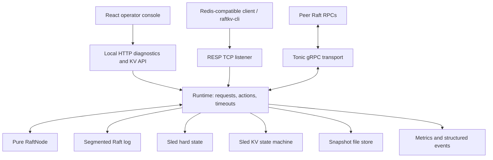

# RaftKV architecture

RaftKV is a Rust workspace for studying replicated state machines, with a React operator console. Consensus logic is separated from disk, networking, clocks, and client protocols. The implemented algorithms and the runtime's operational guarantees must be assessed separately: a pure core containing a protocol is not evidence that every crash or partition scenario is handled by the complete service.

## Components and ownership



| Component | Responsibilities | Important source |
| --- | --- | --- |
| `raft-core` | Election, terms/votes, replication progress, quorum commit, configuration transitions, read coordination | `crates/raft-core/src/node.rs` |
| `raft-storage` | Record framing, segment rotation, recovery, log truncation/compaction, metadata and snapshot files | `crates/raft-storage/src/` |
| `raft-net` | Protobuf conversion, peer connections, synchronous Raft RPC response mapping | `crates/raft-net/src/{client,server,convert}.rs` |
| `kv-state-machine` | Command application, KV/expiry trees, applied cursor, rolling operation hash | `crates/kv-state-machine/src/state.rs` |
| `resp-server` | RESP frames, command parsing, read/write dispatch | `crates/resp-server/src/{codec,commands,handler}.rs` |
| `raftkv-server` | Configuration, side-effect ordering, request completion, HTTP/RESP/gRPC/metrics endpoints | `crates/raftkv-server/src/{main,runtime,config}.rs` |
| `raftkv-cli` | Small RESP smoke-test and status client | `crates/raftkv-cli/src/main.rs` |
| `sim-tests` | Seeded, logical-clock, in-memory network simulation | `crates/sim-tests/src/lib.rs` |
| `linearizability-checker` | Exhaustive model search for short completed GET/SET/DEL/INCR histories | `crates/linearizability-checker/src/lib.rs` |
| `ui` | Browser polling, cluster inspection, KV interaction and technical views | `ui/src/main.jsx`, `ui/src/styles.css` |

## Deterministic core, explicit effects

`RaftNode::step(message)`, `tick()`, and proposal methods return ordered `Action` values. The core uses a seeded ChaCha PRNG for election deadlines and does not read wall time, perform I/O, or create async tasks. Replaying the same configuration, seed, message delivery order, and ticks reproduces its transitions. A seed alone does not reproduce an arbitrary real network schedule.

A serialized runtime driver orders each core transition with its side effects, including inbound peer RPC processing. Proposal and read channels and each pending-waiter map are capped at 1,024; overload returns an explicit error, and canceled waiters are pruned. The action interpreter owns `PersistHardState`, `AppendEntries`, `TruncateLog`, `SendMessage`, `ApplyCommitted`, snapshot actions, read notifications, and metrics. Protocol safety depends on preserving their order: persist a term/vote before acknowledging it; persist log entries before acknowledging replication; apply only committed entries in index order; complete a client write only after the corresponding command has applied.

Peer RPCs return their Raft response on the same gRPC call. The peer client converts that response into an inbox message for the core. Responses do not require a reverse outbound RPC connection. Transport errors invalidate the cached connection and later sends reconnect.

## Write path

1. A RESP command or HTTP mutation becomes a `kv_state_machine::Command`.
2. The runtime enqueues the request and the leader appends a bincode-encoded `Normal` entry at `(current_term, last_index + 1)`.
3. Ordered actions persist the entry and issue bounded AppendEntries batches to followers.
4. Followers validate `prev_log_index` and `prev_log_term`, truncate conflicting suffixes, persist new entries, and acknowledge matching replication progress.
5. The leader computes a quorum replication index. It advances commitment by counting replicas only for an entry in its current term; that commits preceding entries as well.
6. The runtime applies committed commands to sled, advances the applied cursor, and resolves the proposal waiter.

A client timeout is an unknown outcome: the entry may subsequently commit. There is no durable client request deduplication or exactly-once retry protocol. Retrying `INCR` can increment twice.

## Reads and consistency boundaries

RESP KV reads use the read-index path: establish leadership with a fresh quorum acknowledgment in the current term, capture a committed index, and wait for local application through that index before reading KV. A current-term committed entry is required to establish the leader's knowledge of commitment after election. Refer to `RaftNode::read_index`, its acknowledgment handling, and runtime read waiters for the exact implementation.

HTTP key listing and GET are explicitly local applied-state reads and may be stale; they do not use the RESP quorum barrier. Status, topology, local log inspection, and browser-observed events are diagnostics. They are sampled from one process and do not constitute a single atomic cluster-wide snapshot. A disconnected endpoint does not prove that a voter has been removed; a reachable endpoint does not prove that it can commit writes. A hash comparison is meaningful only when replicas have applied the same index.

The system is an educational implementation. Unit tests and local smoke tests are evidence for specific scenarios, not a proof of linearizability across all failures.

## Elections, replication and quorum

Election deadlines are randomized in `[election_timeout_ticks, 2 × election_timeout_ticks)`. Default server timing is a 10 ms tick, 50 ms heartbeat, and a 300 ms lower election bound. Actual elapsed time also includes scheduler delay and blocking storage work.

Pre-vote asks whether a prospective candidacy can obtain support before increasing the durable term. Real voting checks membership, term, prior vote, and log freshness ordered by `(last_log_term, last_log_index)`. A new leader appends a no-op to establish a current-term entry.

Leader-side follower progress contains `match_index`, `next_index`, `Probe / Replicate / Snapshot` state, activity, and in-flight count. Conflict hints identify an earlier retry point. The runtime configures an AppendEntries batch limit of 256 entries and a core progress in-flight limit of 1,024 messages per peer. The transport separately admits at most 32 concurrent sends per peer using a semaphore; excess attempts are dropped for Raft to retry. Heartbeats reclaim stale core in-flight counters so a long outage cannot permanently saturate a recovered peer. These count limits do not establish a complete byte-level memory budget.

For `N` stable voters:

```text
quorum = floor(N / 2) + 1
maximum unavailable voters while retaining quorum = N - quorum
```

| Voters | Quorum | Unavailable voters tolerated |
| ---: | ---: | ---: |
| 1 | 1 | 0 |
| 3 | 2 | 1 |
| 4 | 3 | 1 |
| 5 | 3 | 2 |
| 7 | 4 | 3 |

Joint consensus models `C_old → C_old,new → C_new`; the joint phase needs majorities of both sets. Core `ConfigChange` types and membership protobuf definitions exist. A complete live add/remove workflow additionally needs transport registration, learner catch-up, committed configuration recovery, request routing, and runtime administration binding; the local launcher bootstraps a configured voter set and is not an online membership manager.

Leadership transfer waits for a target to catch up, blocks new proposals during transfer, and emits `TimeoutNow`. Election success still depends on connectivity and votes; it is not guaranteed by the transfer request.

## Persistence and recovery

| Layer | Representation | Durability / recovery detail |
| --- | --- | --- |
| Raft log | `<base_index:020>.log`, 64 MiB target segments | Records contain little-endian `u32 length`, `u32 CRC32C`, and bincode entry bytes. Opening scans records and truncates at the first invalid/incomplete record. |
| Append batches | Ordered records plus `sync_data()` | `SegmentedLog::append` validates batch continuity before mutation and syncs all segments touched by a batch, even when `sync_each_append=false`; that flag controls additional per-record syncs. Power-loss durability still requires dedicated crash testing. |
| Raft metadata | Separate sled database | Hard state `(term, voted_for, commit_index)` is serialized and explicitly flushed. Snapshot index/term are separate keys. |
| KV state | Sled `kv`, `ttl`, `meta` trees | Stores values, sorted expiry index, applied index and operation hash. Multi-tree application is not transactional; partial application and replay of non-idempotent commands require stronger crash recovery design. |
| Snapshot files | `.snap`, `.meta`, temporary files | Store supports chunk writing, file sync and rename. This does not establish complete runtime KV export/import or directory-fsync durability. |

Current snapshot plumbing is incomplete: local snapshot creation does not serialize the KV dataset, peer snapshot payloads are not populated with a complete state image, and installation does not replace KV state. Do not rely on snapshots, compaction, or a snapshot pointer as a recoverable backup. The configurable snapshot threshold is not evidence of a functioning automatic snapshot scheduler.

Application errors and persistence errors mark the runtime failed, stop further consensus processing/dependent acknowledgments and KV access, and remain visible in status/metrics until repair and restart. This fail-closed behavior is separate from transactional recovery of a partially applied command. Clean restart replay skips entries at or below the durable KV applied cursor; that does not make a crash between mutation and cursor update safe.

The core keeps an in-memory log while the storage layer maintains disk records and per-segment offset indexes. Opening a segment reads its contents to reconstruct its offset table; startup work scales with retained log bytes. Snapshot and configuration recovery are important remaining integration work.

## Efficiency model

Let `N` be voters, `L` retained log entries, `B` entries per append batch, `K` keys, and `T` expiry records.

| Operation | Approximate work in this implementation | Consequence |
| --- | --- | --- |
| Leader replication | `O(N × B)` entry copying/serialization per batch round | More voters improve fault tolerance but add replication traffic; they do not shard the keyspace. |
| Stable commit calculation | `O(N log N)` sorting of match indexes | Fine for small consensus groups; use selection/incremental tracking only after profiling. |
| Disk log point lookup | Segment search plus linear offset-index search for point reads; range reads use one lock and initial lookup | Large retained segments increase lookup CPU; binary search is a useful targeted improvement. |
| Log startup | `O(retained bytes)` scan plus in-memory entries | Complete snapshots and validated compaction are needed before claiming bounded recovery cost. |
| KV point operations | Sled tree access plus value/hash bytes | No measured throughput or latency claim is made. |
| Expiry persistence removal | `O(T)` scan | A key-to-expiry reverse index would avoid scanning all expiration records. |
| Key listing / dataset statistics | Potentially `O(K)` | A response limit is not automatically a scan limit; inspect implementation before large datasets. |
| History checker | Up to factorial operation orderings | Suitable for short traces; long histories need partitioning/memoization or another checker. |

Synchronous filesystem and sled operations run inside runtime work; under slow disks they can delay timer processing. Further optimization should preserve persistence ordering while moving blocking work to a dedicated storage pipeline, extend admission control beyond the bounded request channels, batch compatible fsyncs, and measure tail latency before tuning.

## Operator API and observations

| Endpoint | Scope | Contract |
| --- | --- | --- |
| `GET /api/status` | Local diagnostics | Identity, endpoints, health/failure, membership/quorum, timing config, indexes, queues/counters, capabilities; leader-only peer progress. |
| `GET /api/keys` | Local applied-state inspection | Complete byte-array key inventory with consistency/node/applied-index metadata. |
| `GET /api/keys/<encoded-key>` | Local applied-state inspection | UTF-8/lossy-decoded value or null; no quorum read barrier. |
| `PUT /api/keys/<encoded-key>` | Leader mutation | JSON `{ "value": "..." }`; proposes SET and waits for application. |
| `DELETE /api/keys/<encoded-key>` | Leader mutation | Proposes DEL and reports whether a key was removed. |
| `GET /api/log` | Local retained-log inspection | At most 100 tail entry metadata records, no command values, no query pagination. |
| Metrics listener | Local runtime sample | Node-labeled Raft/index/health/uptime/key gauges and cumulative runtime counters. |

HTTP accepts up to 16 KiB of headers and 128 KiB of body, with Content-Length for PUT and a five-second request-read deadline. Keys are strictly percent-decoded UTF-8. RESP decoding bounds frames to 8 MiB, arrays to 16,384 elements and nesting to 32. These protocol bounds do not establish a complete per-process memory budget.

The Vite gateway forwards `/nodes/<port>/api/...` to localhost only. Browser endpoint configuration is separate from consensus membership. Events and rates are derived from bounded browser samples; they are neither a persisted audit log nor latency benchmark measurements. The key inventory is currently collected in full; browser pagination does not reduce its server work.

## Security and deployment boundaries

Peer gRPC and RESP are plaintext. No complete authentication, ACL, TLS/mTLS, tenant isolation, or rate-limiting layer is implemented. Keep HTTP operator APIs on loopback or an authenticated restricted network. Local dashboard routing is designed around localhost port allocation, not arbitrary remote service discovery.

Docker Compose provides bridge-network examples with named peers and separate volumes. Helm derives unique IDs from pod ordinals via a CLI override, enables parallel pod bootstrap/not-ready peer DNS, and supplies an ephemeral data volume when persistence is disabled. Manifest rendering/live Kubernetes validation was not executed during this review. TCP probes establish socket availability, not Raft quorum or write readiness.

See [PROJECT_REPORT.md](PROJECT_REPORT.md) for feature maturity, validation expectations and the prioritized engineering plan; [HOW_TO_RUN.md](HOW_TO_RUN.md) for reproducible commands.

Key count diagnostics use an in-memory atomic count initialized from sled at open and updated alongside successful key mutations, avoiding a full key scan on every status/metrics poll. Key listing still scans the local keyspace; cursor pagination remains a scaling improvement.
