<p align="center">
  <picture>
    <source media="(prefers-color-scheme: dark)" srcset="docs/brand/raftkv-logo-dark.png" />
    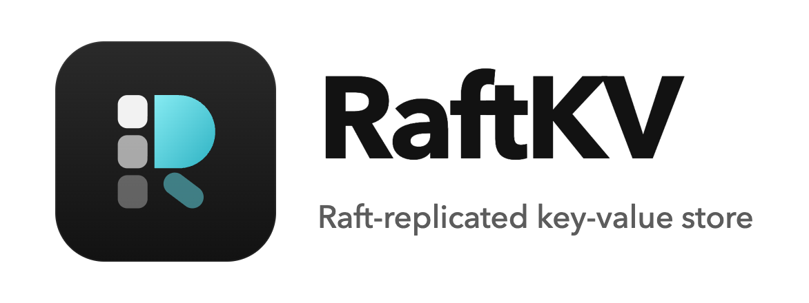
  </picture>
</p>

<h1 align="center">RaftKV</h1>

<p align="center">
  <strong>A Raft-replicated key-value store in Rust, with a live operator console and a RESP2-compatible client subset.</strong>
</p>

<p align="center">
  
  
  
  
</p>

<p align="center">
  <a href="#quick-start">Quick start</a> ·
  <a href="#the-operator-console">Console tour</a> ·
  <a href="#what-is-implemented">What's implemented</a> ·
  <a href="#protocol-and-api">Protocol</a> ·
  <a href="#workspace-and-reading-guide">Reading guide</a> ·
  <a href="#validation">Validation</a>
</p>

<p align="center">
  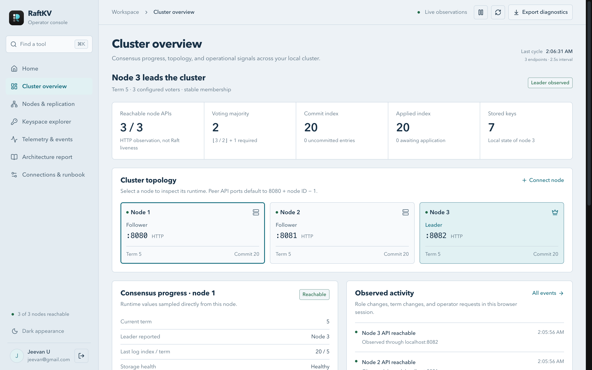
</p>

RaftKV separates a deterministic consensus core from disk, networking, timers and client handling. Nodes replicate commands over gRPC, persist a CRC32C-framed log and hard state, and apply committed operations to a sled-backed KV store. The React console exposes real node diagnostics, replication progress, local data inspection and leader-routed mutations.

> [!NOTE]
> **Status: 0.1.0, unreleased educational implementation.** Snapshot state transfer, transactional crash recovery, live membership administration and authentication remain unfinished. This is a platform for studying and extending distributed systems; review [PROJECT_REPORT.md](PROJECT_REPORT.md) for evidence and engineering priorities.

---

## Quick start

**Prerequisites:** Rust stable (workspace minimum declaration: 1.75), Python 3 for launcher checks, Node.js 22.12 or newer with npm for the console, and macOS, Linux or WSL. The build vendors `protoc`. Use the current stable toolchain for the resolved dependencies.

```bash
cargo build --workspace --release
./scripts/run_cluster.sh --no-build      # starts three voters and waits for a leader
npm --prefix ui ci
npm --prefix ui run dev                  # console at http://127.0.0.1:5173
```

Open [the operator console](http://127.0.0.1:5173). The launcher waits for all node APIs and a shared leader. Default node ports:

| Node | Raft gRPC | RESP | Metrics | JSON API |
| --- | ---: | ---: | ---: | ---: |
| 1 | 7001 | 6379 | 9101 | 8080 |
| 2 | 7002 | 6380 | 9102 | 8081 |
| 3 | 7003 | 6381 | 9103 | 8082 |

Find the leader, then use its RESP port in place of the example address:

```bash
./target/release/raftkv-cli --addr 127.0.0.1:6379 status
./target/release/raftkv-cli --addr 127.0.0.1:6379 members
./target/release/raftkv-cli --addr 127.0.0.1:6380 set greeting "hello raft"
./target/release/raftkv-cli --addr 127.0.0.1:6380 get greeting
```

The CLI returns RESP output and does not follow leader redirects automatically; a follower answers writes with `-MOVED`. `CLUSTER NODES` is an informational peer list, not a complete Redis Cluster discovery implementation.

```bash
./scripts/stop_cluster.sh
```

Logs, configs, PID files and data remain under `.run/` for restart. Pre-existing untracked or manual processes must be stopped by their own PIDs; the shutdown helper only stops processes it can identify as belonging to its run directory.

---

## The operator console

The console is a local Vite app that proxies `/api` to each node's JSON API on loopback. Every number on screen is an **independent HTTP sample** from a node. The console says so wherever it matters, and never presents API reachability as proof of quorum. All screenshots below are light mode, captured at 2× (desktop) and 3× (mobile) from a real three-node cluster started with `./scripts/run_cluster.sh`, signed in with a local profile.

### Sign in

A local operator profile (name and email) personalizes the workspace. It lives in the browser tab's session storage. **It is not API authentication**: node APIs remain unauthenticated.

<p align="center">
  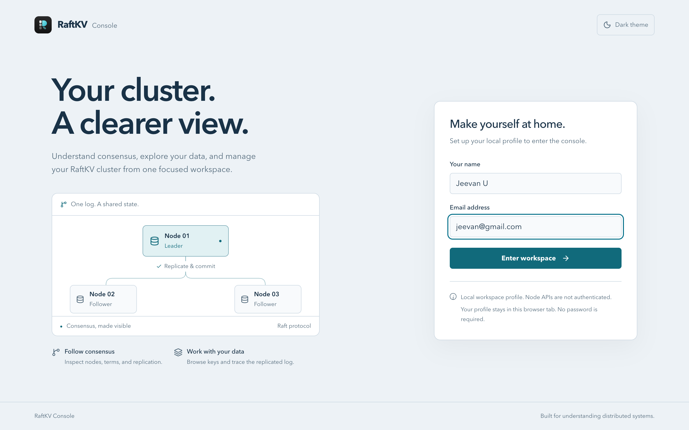
</p>

### Home

Reachable endpoints, the observed leader and term, the committed index, and one-click jumps into each node, the keyspace, replication and telemetry.

<p align="center">
  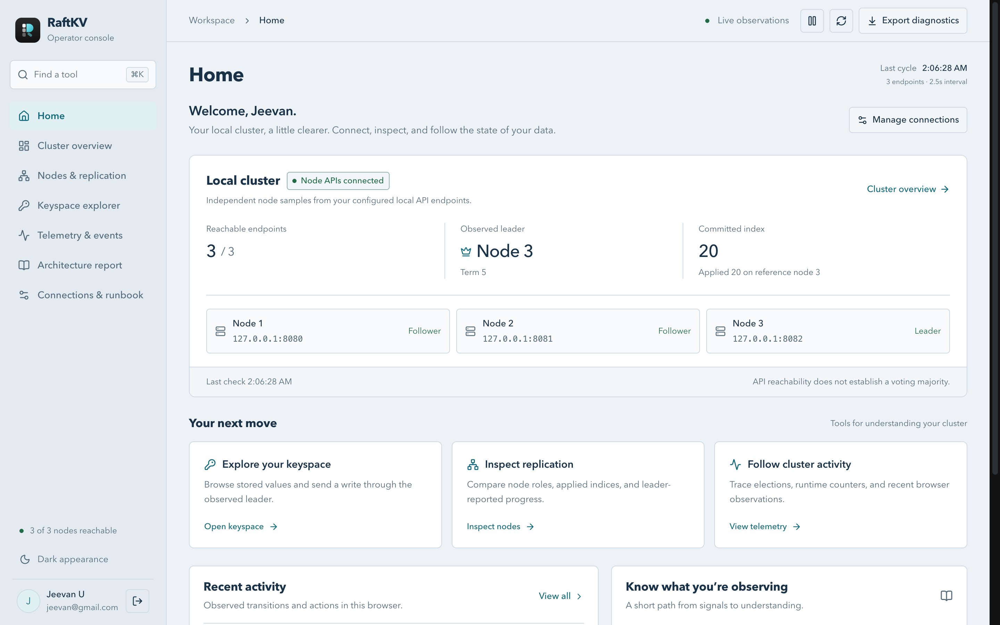
</p>

### Cluster overview

Leadership, voting majority, commit and applied indices, the topology, sampled commit progression, and a state-integrity check. The check compares hashes only when the nodes' applied indices match.

<details open>
<summary><strong>Full page</strong></summary>
<p align="center">
  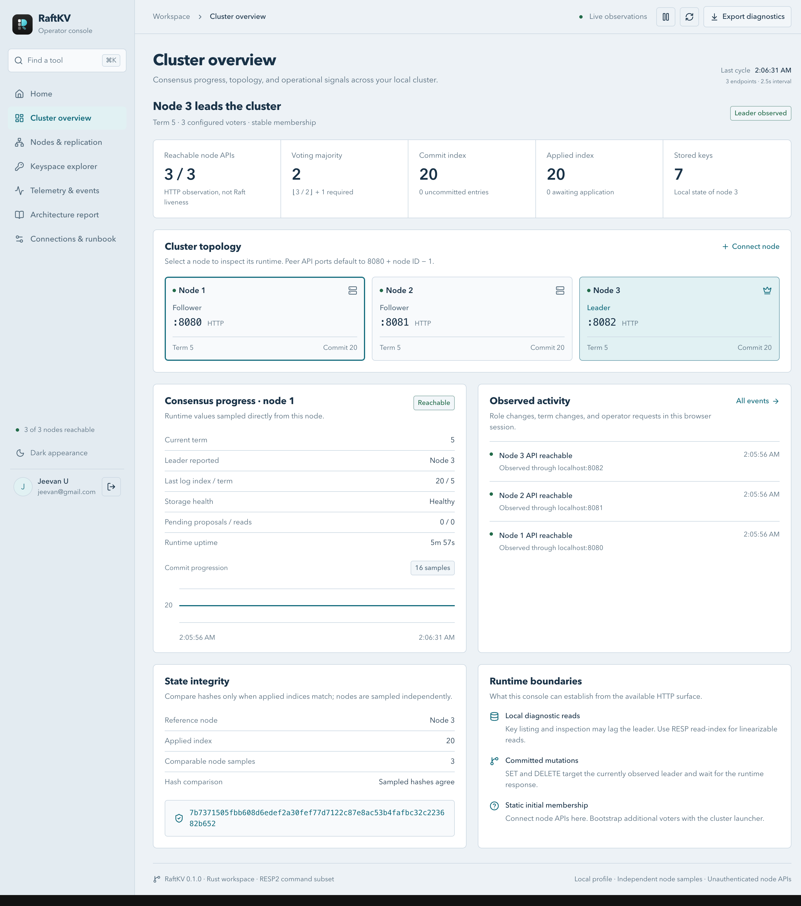
</p>
</details>

### Nodes & replication

The node observation matrix, per-node consensus state, log and snapshot boundaries, read-only runtime configuration, and the leader's per-peer match and next indices. The **replicated log inspector** lists retained entries (index, term, kind and payload size) without exposing command values.

<p align="center">
  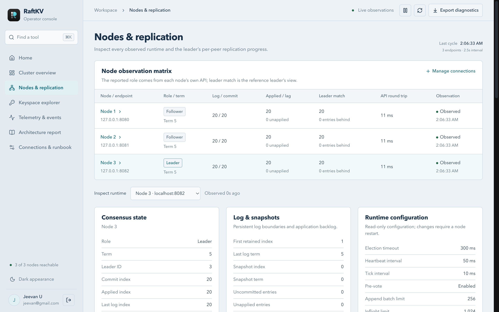
</p>

<details>
<summary><strong>Full page, including peer progress and the replicated log</strong></summary>
<p align="center">
  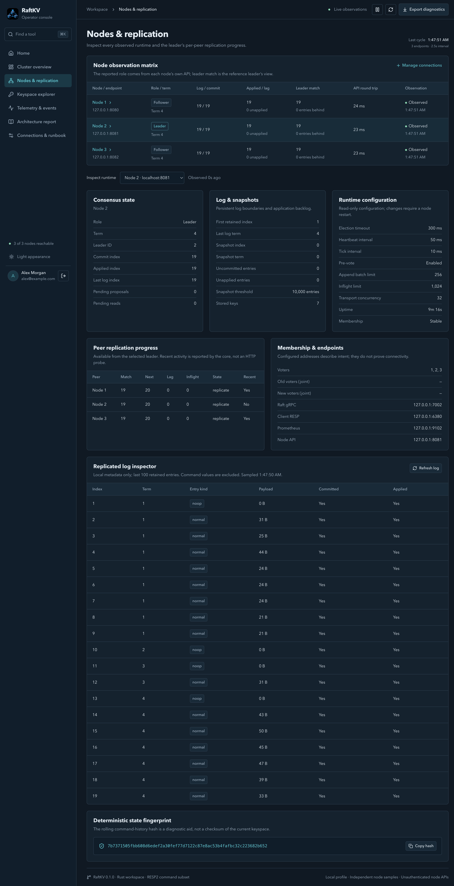
</p>
</details>

### Keyspace explorer

Browse and filter a node's **local applied state**, inspect a value with its source node and applied index, and propose a `SET` or `DELETE`. Mutations are always routed to the observed leader.

<p align="center">
  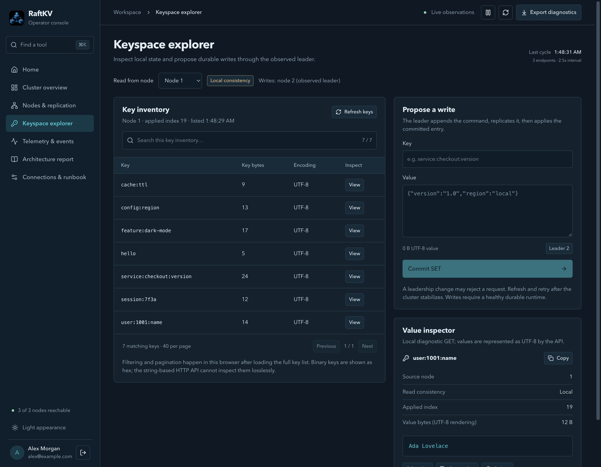
</p>

### Telemetry & events

Proposal and Raft send rates computed from runtime counter deltas, status-API latency, commit and applied progression, all ten runtime counters, and a filterable history of browser-observed events. The Prometheus endpoint and the bundled Grafana dashboard and alerts cover persistent monitoring.

<p align="center">
  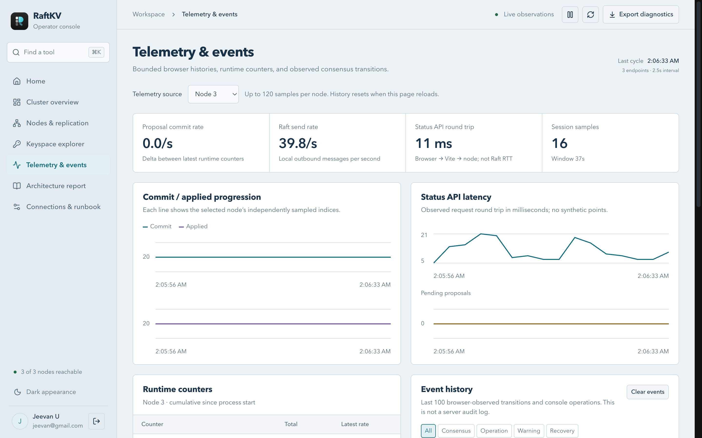
</p>

### Architecture report & runbook

A source-grounded field guide: the request and effect pipeline, crate layers, the consensus invariant map, storage mechanics and known limitations. The runbook pane connects more node APIs and generates the commands for a fresh, larger cluster.

<table>
  <tr>
    <td width="50%">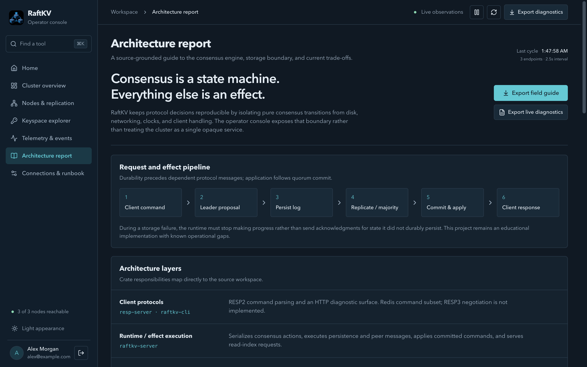</td>
    <td width="50%">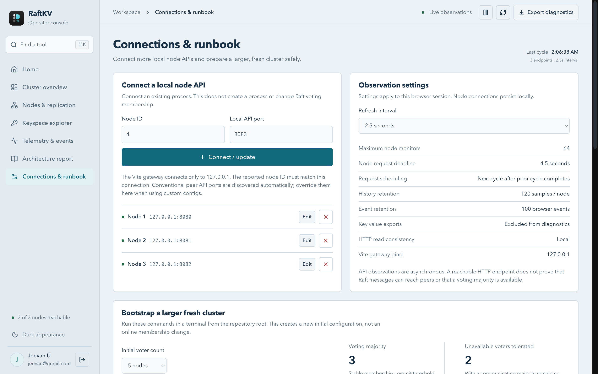</td>
  </tr>
  <tr>
    <td align="center"><sub>Architecture report</sub></td>
    <td align="center"><sub>Connections & runbook</sub></td>
  </tr>
</table>

### Keyboard, dark appearance and mobile

<kbd>⌘</kbd> <kbd>K</kbd> / <kbd>Ctrl</kbd> <kbd>K</kbd> opens tool search, navigated with arrows, <kbd>Enter</kbd> and <kbd>Esc</kbd>. Every pane has a bookmarkable URL fragment. Light and dark appearances persist locally; the dark appearance uses neutral graphite grays with teal reserved for actions and leadership. Reduced-motion preferences are respected.

<table>
  <tr>
    <td width="50%">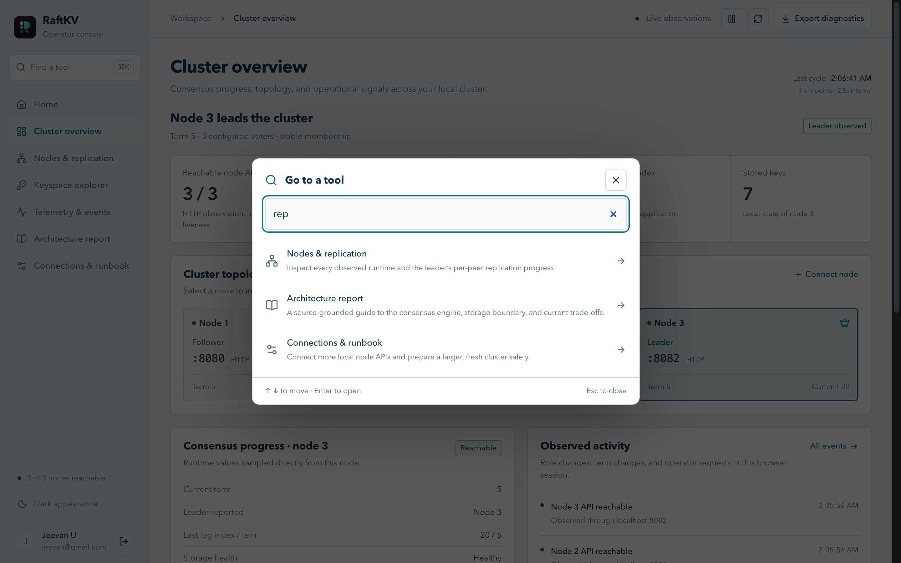</td>
    <td width="50%">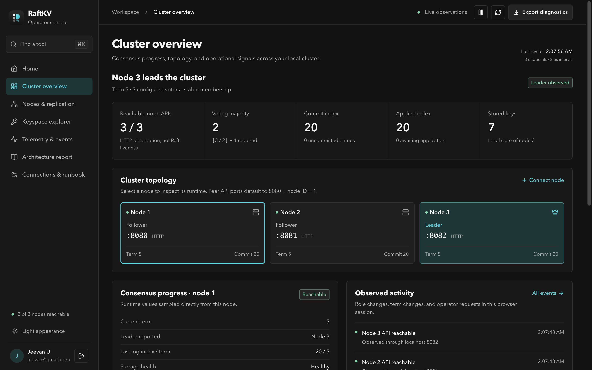</td>
  </tr>
  <tr>
    <td align="center"><sub>Tool search (⌘K)</sub></td>
    <td align="center"><sub>Dark appearance</sub></td>
  </tr>
</table>

The layout adapts down to 320px with no horizontal overflow, 40–44px touch targets, and a full-width navigation list.

<table>
  <tr>
    <td width="25%">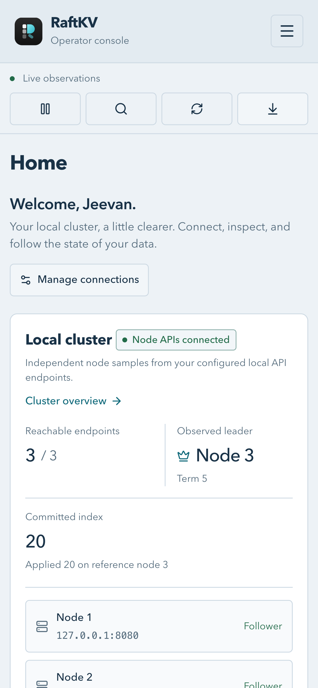</td>
    <td width="25%">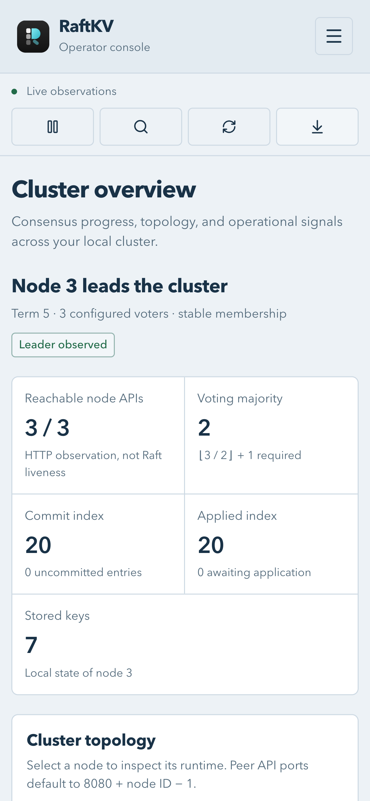</td>
    <td width="25%">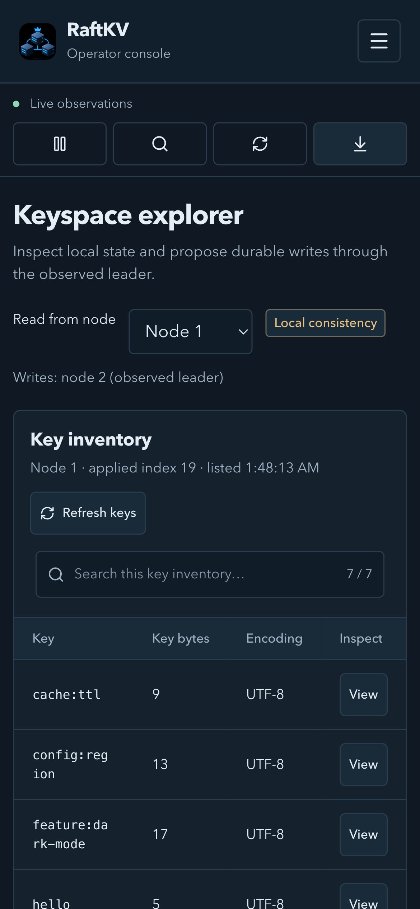</td>
    <td width="25%">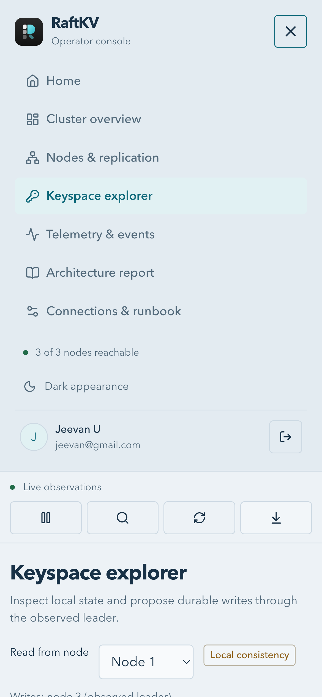</td>
  </tr>
  <tr>
    <td align="center"><sub>Home</sub></td>
    <td align="center"><sub>Overview</sub></td>
    <td align="center"><sub>Keyspace</sub></td>
    <td align="center"><sub>Navigation</sub></td>
  </tr>
</table>

---

## What is implemented

- Pure Raft elections, pre-vote, log matching/conflict repair, current-term commit, stable/joint quorum calculations and core leadership-transfer primitives.
- Request-correlated quorum read-index for RESP reads, with application barriers and stale-leader rejection.
- Serialized core transitions and side effects, bounded request channels, proposal/read timeouts and operation counters.
- Segmented log with CRC32C tail recovery, contiguous-batch validation and sync of touched segments; explicitly flushed sled hard state.
- Sled KV commands and an operation-history hash; a RESP2 command subset and tonic peer RPCs.
- Configurable local bootstrap of 1–31 voters with separate ports, readiness checks and PID-scoped shutdown.
- A live operator console, JSON diagnostics, Prometheus text endpoint, browser event history, log inspection and technical documentation.
- Seeded consensus simulation, a short-history exhaustive checker, regression tests and real four/five-node integration scenarios.

Core membership and snapshot types do not imply complete operational add/remove or dataset snapshot recovery. Dashboard reads inspect **local applied state** and may be stale; use the leader's RESP endpoint for quorum-confirmed KV reads.

```text
client ──RESP──▶ leader ──▶ raft-core (pure) ──▶ actions
                              │                    ├─ persist log + hard state (raft-storage)
                              │                    ├─ AppendEntries to peers   (raft-net, gRPC)
                              ◀── quorum ack ──────┘
                      commit ─▶ apply to sled KV (kv-state-machine) ─▶ reply to client
```

## More nodes

Bootstrap five voters in a fresh directory:

```bash
./scripts/run_cluster.sh --nodes 5 --run-dir .run-five --no-build
# After inspection:
./scripts/stop_cluster.sh --run-dir .run-five
```

Stop the previous cluster first, because these launchers use the same localhost port allocation. Five voters require three acknowledgments and tolerate two unavailable voters; seven require four and tolerate three. More voters replicate the full dataset and do not shard writes.

Use the console's connection controls to inspect additional node API ports. Adding a browser connection records an endpoint; **it does not add a Raft voter**. The launcher rejects changing a persisted cluster's voter count. Safe online membership requires additional runtime/admin integration.

## Protocol and API

The RESP command surface includes `PING`, `ECHO`, `QUIT`, `INFO`, `CLUSTER NODES`, `CLUSTER INFO`, `DBSIZE`, `GET`, `MGET`, `EXISTS`, `SET`, `DEL`, `INCR`, `DECR`, `MSET`, `EXPIRE`, `PERSIST` and `FLUSHDB`. `SELECT`, `COMMAND` and `CLIENT` have limited compatibility behavior. The codec supports RESP2 values and inline commands; full RESP3/`HELLO`, Redis transactions, pub/sub and Redis Cluster semantics are absent.

Expiry representation exists, but `TTL` returns `-1`, periodic replicated expiration ticks are not scheduled, and expiry replacement semantics need further work. Do not rely on Redis-equivalent TTL behavior.

The local HTTP API serves status and data inspection; mutations require a leader. It validates JSON/percent-encoded UTF-8 keys and bounds HTTP request sizes. See [HOW_TO_RUN.md](HOW_TO_RUN.md) for endpoint examples and [ARCHITECTURE.md](ARCHITECTURE.md) for consistency boundaries.

## Workspace and reading guide

| Path | Responsibility |
| --- | --- |
| `crates/raft-core` | Pure consensus transitions, log and peer progress |
| `crates/raft-storage` | Durable log, hard state and snapshot file primitives |
| `crates/raft-net` | gRPC peer clients/server and protobuf conversion |
| `crates/kv-state-machine` | Sled KV commands, applied cursor and operation hash |
| `crates/resp-server` | RESP2 codec, command parsing and dispatch |
| `crates/raftkv-server` | Runtime, HTTP/RESP/gRPC/metrics listeners |
| `crates/raftkv-cli` | Operator smoke-test client |
| `crates/sim-tests`, `crates/linearizability-checker` | Simulation and short-history model checking |
| `ui` | React/Vite operator console and local node gateway |
| `proto`, `deploy`, `helm`, `grafana` | Protocol contracts and deployment/observability examples |

| Document | What it answers |
| --- | --- |
| [HOW_TO_RUN.md](HOW_TO_RUN.md) | How to launch, connect, inspect, stop and troubleshoot |
| [ARCHITECTURE.md](ARCHITECTURE.md) | Components, request flow, persistence and efficiency |
| [RAFT_NOTES.md](RAFT_NOTES.md) | Consensus concepts mapped to source and invariants |
| [PROJECT_REPORT.md](PROJECT_REPORT.md) | Feature maturity, confirmed validation and prioritized technical roadmap |
| [CHANGELOG.md](CHANGELOG.md) | Delivered changes and remaining integration work |
| [ui/README.md](ui/README.md) | Console usage, profile semantics and console tests |

## Validation

```bash
cargo fmt --check
cargo test --workspace
cargo clippy --workspace --all-targets -- -D warnings
python3 scripts/tests/test_launcher.py
python3 scripts/tests/live_cluster.py --nodes 4
python3 scripts/tests/live_cluster.py --nodes 5
npm --prefix ui test
npm --prefix ui run build
npm --prefix ui run test:e2e     # Playwright: sign-in, navigation, themes, writes, 320–1440px layouts
```

The live integration suite uses real processes and covers election, replication, quorum reads, failover, isolated-leader read rejection, clean restarts, deletion and hash agreement. It is not a power-loss/partial-apply crash harness. The simulator exercises in-memory consensus schedules; `scripts/jepsen_run.sh` skips unless an external `JEPSEN_DIR` is provided.

## Deployment and limitations

Docker Compose and Helm examples are available. Helm derives unique node IDs from StatefulSet ordinals and permits parallel peer bootstrap; render/live Kubernetes validation is still required. Client services distribute connections across followers as well as leaders, so client routing must handle leadership explicitly. Keep unauthenticated operator APIs on loopback or an authenticated restricted network.

Remaining priorities are transactional KV application and recovery, complete snapshots, robust online membership, full expiry semantics, security, and reproducible benchmarks/soak testing. Client timeout outcomes are ambiguous and retries are not exactly once. See the report before relying on the project for durable application data.

## Brand

The mark is an **R** built from the replicated log: three stacked entries form the stem (newest brightest), the committed state forms the teal bowl, and the leg carries replication to followers. Sources: [`ui/public/mark.svg`](ui/public/mark.svg), with PNG renders in [`docs/brand/`](docs/brand/).

## Contributing and license

For consensus changes, identify the invariant and add a regression covering the failure schedule. Run relevant checks and report limitations accurately. Workspace metadata declares Apache-2.0; see repository history for licensing details.
